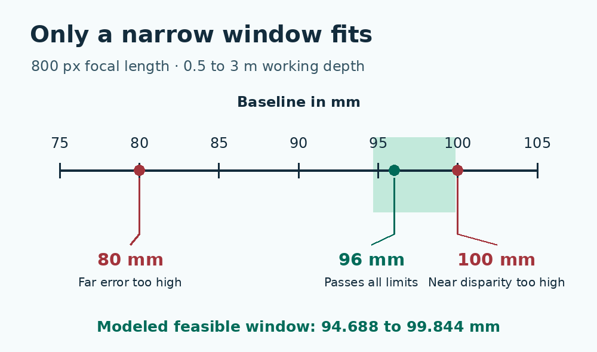

# Stereo camera baseline design in Python

Choose the separation between two camera centers for a working depth range. The calculator intersects three design limits and checks actual mounting positions. It uses an ideal horizontal rectified stereo model, runs offline and controls no hardware.

[Full lesson at WIFA Robotics](https://wifarobotics.com/learn/stereo-camera-baseline/)



## First run

1. Install [Python 3.11 or newer](https://www.python.org/downloads/). Open Terminal on macOS or Linux and run `python3 --version`. On Windows open PowerShell and run `py -3 --version`; use `py -3` instead of `python3` in the commands below. If the launcher is unavailable, try `python --version` and use `python` if it is 3.11 or newer.
2. On GitHub choose **Code → Download ZIP** and extract it. Open a terminal in the extracted folder that contains `baseline.py` and `examples`. Nothing needs to be installed with pip.
3. Run these commands from that folder, one at a time.

```sh
python3 baseline.py examples/narrow-window.json
python3 baseline.py examples/no-window.json
python3 baseline.py examples/no-mount.json
python3 baseline.py examples/disparity-floor.json
python3 -m unittest discover -s tests -v
```

| File | Continuous interval (mm, rounded) | Passing mounts | Exit |
| --- | --- | --- | --- |
| narrow-window.json | 94.688 to 99.844 | 96 mm | 0 |
| no-window.json | Empty | None | 1 |
| no-mount.json | 94.688 to 99.844 | None | 1 |
| disparity-floor.json | 90.938 to 99.844 | 96 mm | 0 |

Exit 1 is an expected engineering result when no listed mount passes. Exit 2 means the input or arguments are invalid. Read the code immediately after the command with `echo $?` in Bash or `$LASTEXITCODE` in PowerShell.

## Make a new design

Copy `examples/narrow-window.json` and edit the copy. Use numbers without quotation marks. Keep the exact field names:

* `focal_px` is the **rectified horizontal focal length** in pixels at the processing resolution.
* `near_mm` and `far_mm` bound optical axis depth, not radial distance.
* `error_px` is a chosen symmetric bound on the additive disparity error, not a standard deviation or a percentage.
* `depth_budget_mm` is the allowed absolute error in depth due to disparity error alone.
* `min_px` and `max_px` are the inclusive positive lower and upper usable disparities in pixels. Use the actual configured and validated range. In OpenCV, `numDisparities` is a count, not a maximum coordinate.
* `mounts_mm` lists positive center separations your rig can physically realize.

For each mount the output shows the smallest modeled measured disparity at the far plane, the largest at the near plane and the worst far depth error. The continuous window ignores whether a rail has a hole there. Equality passes, but a real rig should retain headroom. Comparisons use exact fractions; displayed numbers are rounded to three decimals.

## Troubleshooting

* **File not found:** open the extracted directory, then use `ls` or `dir` to locate `baseline.py` and `examples`.
* **Every large mount exceeds the ceiling:** a wider baseline increases disparity. Check the near depth and the matcher range. Do not substitute image width for the matcher ceiling.
* **No error bound at a mount:** the modeled measured disparity can reach zero, so the inverse depth error can grow without bound.
* **Plausible output but wrong real depth:** verify units, the rectified calibration at the actual resolution, principal point offsets and the matcher's disparity scale and invalid mask. Do not use this formula directly for an unrectified or unequal principal point pair.

No cameras were measured. The model does not account for calibration error, occlusion, synchronization, lighting, matcher outliers, distortion left after rectification, field overlap or mounting tolerances. The calculator is a first design screen. Use independent depth references and representative physical targets before committing to a rig.

Sources: [OpenCV calibration and reprojection](https://docs.opencv.org/4.x/d9/d0c/group__calib3d.html), [OpenCV StereoSGBM parameters](https://docs.opencv.org/4.x/d2/d85/classcv_1_1StereoSGBM.html), [Basler depth and disparity geometry](https://docs.baslerweb.com/stereovisard/rc_visard/en/stereo_general).

## Regenerate illustrations

The WebP files are optional for running the calculator. With Pillow and DejaVu Sans available, run `python3 diagrams/draw.py` to regenerate both from the editable source. The baseline window uses the same example data as the command above.
